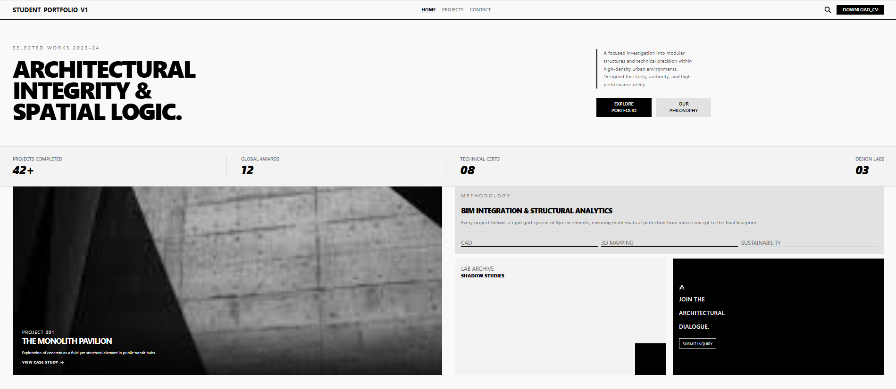

# Tailwind Architectural Portfolio 

3 page brutalist portfolio (Home, Projects, Contact) built with Tailwind CSS v4 via the Play CDN.

## Custom colors with `@theme`
I defined my palette inside `<style type="text/tailwindcss">`:

    @theme {
      --color-bodyc: #f9f9f9;
      --color-steel: #5e5e5e;
      --color-ash: #e2e2e2;
      --color-light-gray: #f3f3f3;
    }

Tailwind turns each `--color-*` variable into utilities, so I can write `bg-bodyc`, `text-steel` or `bg-ash` like built-in classes.

## A challenge solved with CSS Grid
The "Monolith Pavilion" card has text on top of an image, but `position: absolute` was not allowed.
I made the card a single cell grid and placed both the image and the text box in the same cell with `col-start-1 row-start-1`.
`self-end` pushes the text to the bottom, `z-10` keeps it above the image, and `grid-rows-1` stops the image from making the card taller.